# WorkWave

**Tech work, on request.** WorkWave is a MERN web app where clients post a technical job (web development, logo design, content, digital marketing or graphic design) with their own budget. A WorkWave admin reviews each request and accepts or rejects it, and the client tracks the status and pays for accepted work with PayPal.

**Live site:** https://work-wave-gray.vercel.app

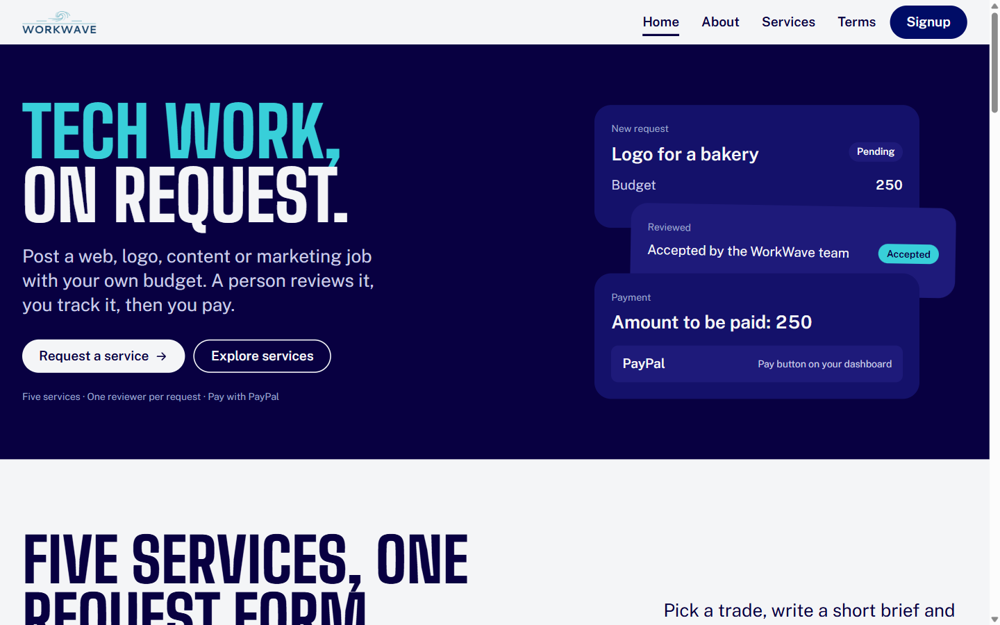

---

## Contents
- [Features](#features)
- [A tour of the site](#a-tour-of-the-site)
- [How a request moves through the app](#how-a-request-moves-through-the-app)
- [Tech stack](#tech-stack)
- [Project structure](#project-structure)
- [Running it locally](#running-it-locally)
- [Environment variables](#environment-variables)
- [API reference](#api-reference)
- [Deployment](#deployment)
- [Design system](#design-system)
- [Known limitations](#known-limitations)

---

## Features
- **Client-set budgets.** Clients choose the service, write the brief and name their price. Nobody quotes them first.
- **Human review.** Every request starts as *Pending*. An admin accepts or rejects it from a queue, and the client sees the new status on their dashboard.
- **PayPal payment.** Accepted requests show a **Pay** button that opens PayPal for the request's budget.
- **Two roles, one app.** Clients and admins sign up and log in on the same page, and each lands on their own dashboard.
- **Job slip builder on the home page.** Pick a service and type a budget to see your request take shape. "Send this request" carries those values into the real request form.
- **Responsive.** Every page works from a 390px phone to a wide desktop, with no sideways scrolling.
- **Accessible by default.** One heading hierarchy per page, labelled form fields, visible focus rings, keyboard-operable controls, a skip link, and reduced-motion support.

---

## A tour of the site

### Home `/`
The first screen states what WorkWave does and offers two actions: **Request a service** and **Explore services**. On the right, three stacked cards show a request's life: a new request (*Pending*), the review (*Accepted*) and the payment.

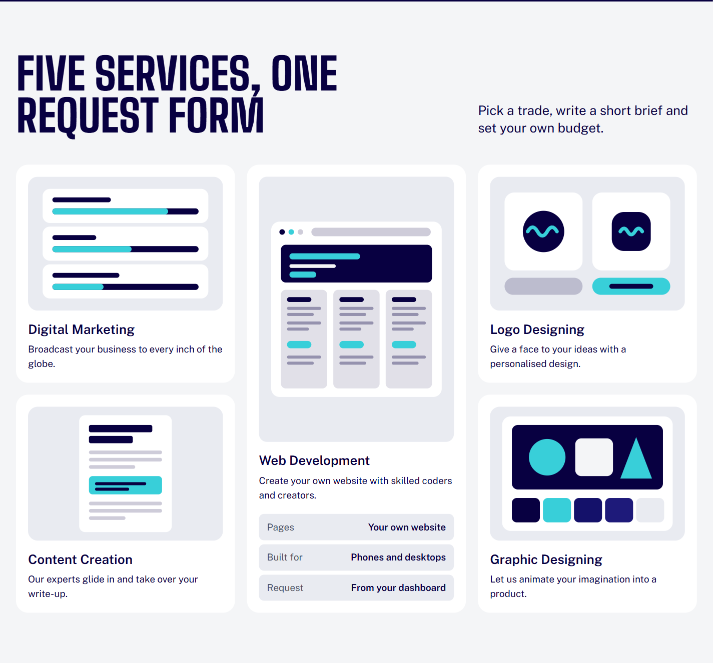

- **Five services, one request form.** Each card has a small drawing of the service. Clicking a card opens that service's own section on the Services page, not just the top of it.
- **One slip, one job.** The interactive job slip: choose a service chip, type a whole-number budget, and the slip's summary rows update as you go. "Send this request" stays disabled until the budget is valid and tells you why.

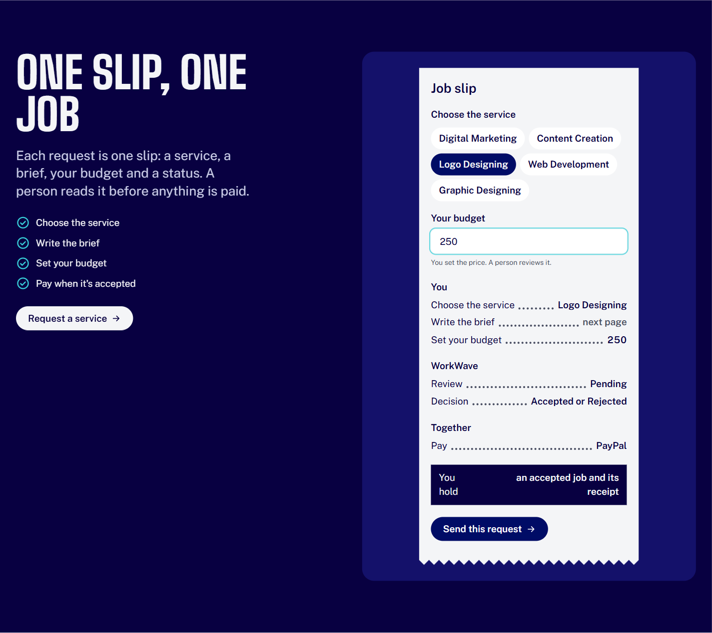

- **Track every request.** A static preview of the client dashboard, with count cards and three sample requests in different states.

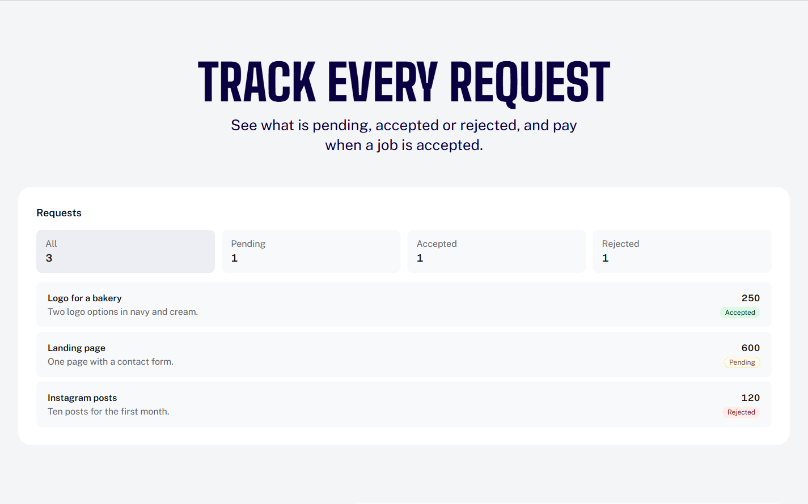

- **Questions.** An FAQ that answers only what the app really does: who sets the price, what happens after posting, editing a request, paying, and which services exist.
- **Post your first job.** A closing call to action.

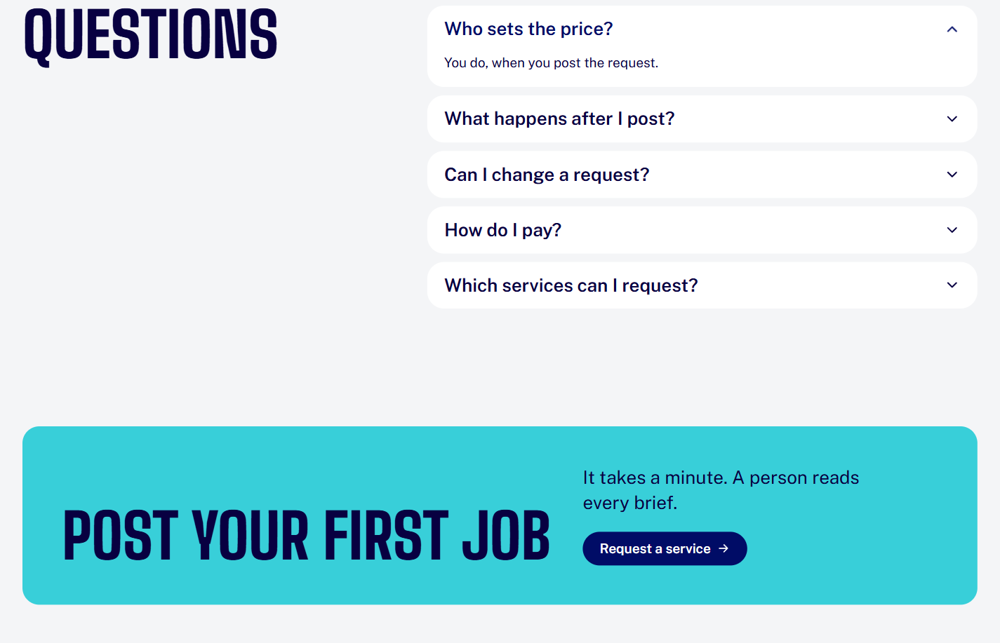

### Services `/services`
One section per service, each with its own address so it can be linked directly: `#svc-marketing`, `#svc-content`, `#svc-logo`, `#svc-web` and `#svc-graphic`. Each section ends with **Request this service**.

| Services page | Linked straight to `#svc-web` |
|---|---|
| 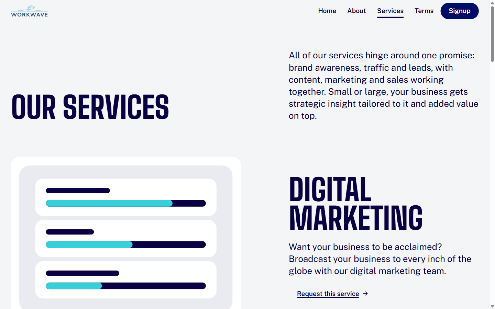 | 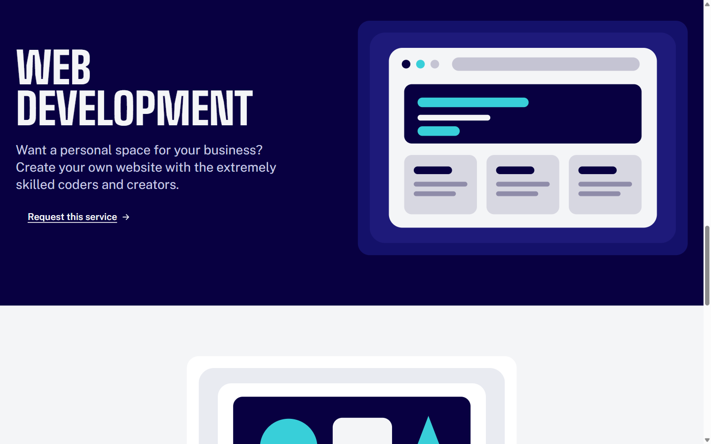 |

### About `/about` and Terms `/privacy`
About explains who WorkWave is for. Terms holds the terms and conditions as a single readable column.

| About | Terms |
|---|---|
| 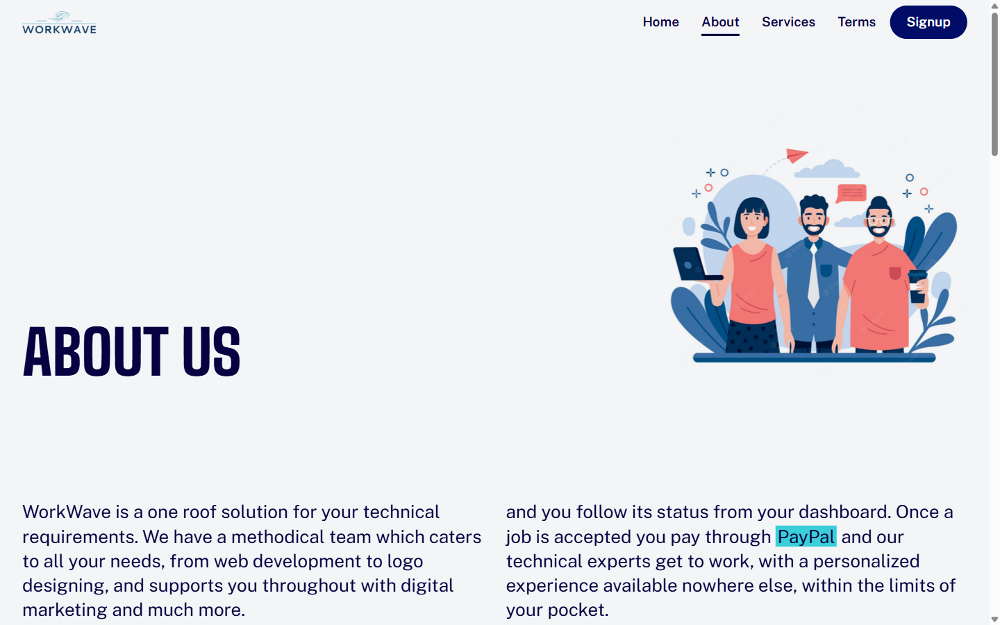 | 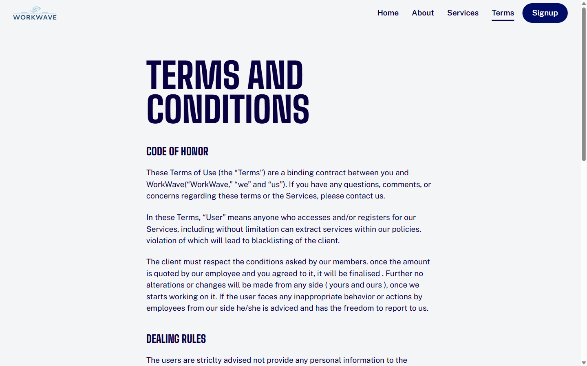 |

### Sign up and log in `/signup`
One card with **Sign up** and **Log in** tabs.
- Choose a role, **User** or **Admin**, with a two-option switch.
- Sign up asks for name, email and password, plus a phone number with country code for client accounts. Log in asks for email and password.
- Every field has a visible label, the password has a show/hide toggle, and server errors appear inline above the button.
- After logging in you go to your dashboard, or back to the page that sent you to log in.

| Sign up | Log in |
|---|---|
| 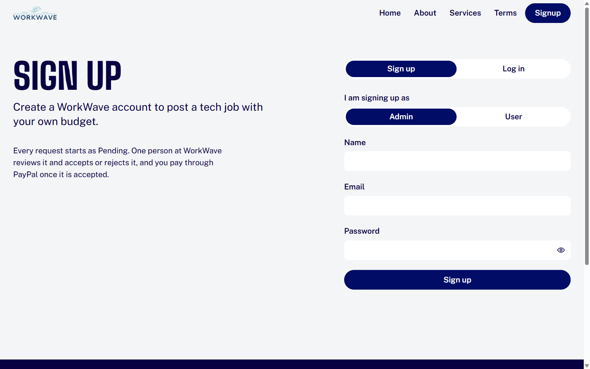 | 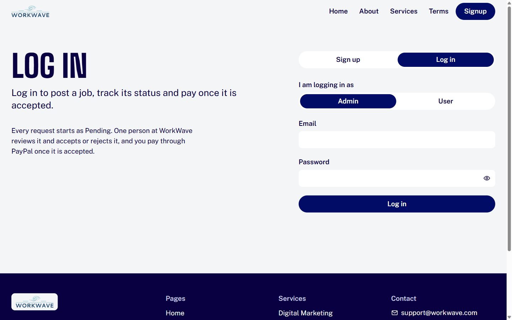 |

### Client dashboard `/userdashboard`
Signed-in clients see their requests.
- **Count cards** (All, Pending, Accepted, Rejected) double as filters, and the counts come from your real requests.
- Each request row shows its title, description, budget and status.
- **Edit** opens a dialog to change the title, description and budget. **Delete** asks for confirmation and names the request.
- Accepted requests get **Pay**, which opens a dialog with the amount and the PayPal buttons.
- Loading shows placeholder rows. With no requests yet, you see an empty state with a **Request a service** button. If loading fails, an inline message offers **Retry**.

### Request a service `/requestservice`
A form with service, description and budget in whole US dollars, plus a note on what happens next. If you came from the home page slip, or from a **Request this service** link on the Services page, the service and budget are already filled in and a note says so.

### Admin queue `/admindashboard`
Signed-in admins see every request in a queue, filtered by status with count cards. Opening a request shows the full brief, budget and client details, with **Accept** and **Deny**. After an action, the status pill updates in place and the counts recalculate.

### On a phone
The header collapses into a **Menu** button that opens the same links as a full-width sheet; Escape closes it. Grids become single columns, and the dashboard tabs scroll sideways.

| Home | Menu open | Job slip |
|---|---|---|
| 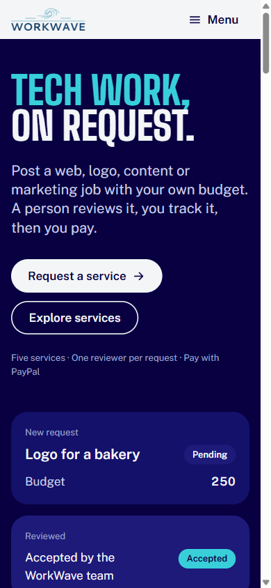 | 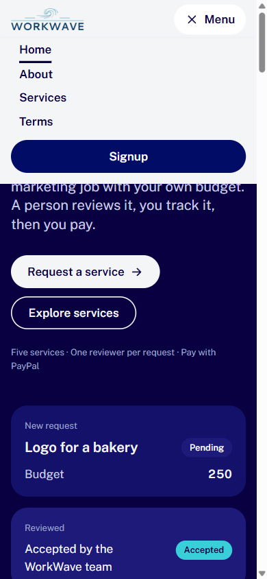 | 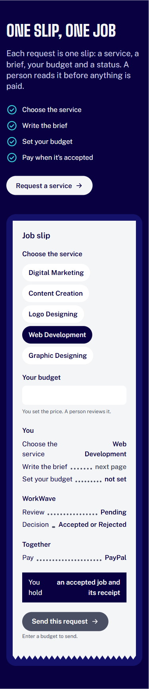 |

### Small things that are easy to miss
- **One header everywhere.** Marketing pages and dashboards share the same header, and nothing shifts when you move between them. The page always reserves room for the scrollbar.
- **Navigation lands where it should.** Changing page scrolls to the top, links like `/services#svc-web` scroll to that section below the header, and the browser Back button returns you to where you were.
- **"Request a service" knows who you are.** Guests go to sign up, clients go straight to the request form, and admins go to their queue.
- **Protected routes.** Opening a dashboard without being signed in sends you to `/signup`, and after logging in you return to the page you wanted.
- **Motion respects your settings.** Sections fade in as you scroll. With "reduce motion" turned on in your OS, everything appears at once.
- **Live state, no reloads.** Logging in or out updates every part of the page immediately, and other open tabs follow.

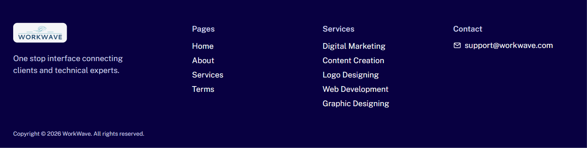

---

## How a request moves through the app

```text
Client                         WorkWave admin               Client
------                         --------------               ------
Sign up / log in  ─────►  Request a service   ─────►  Pending  ─────►  Accept / Deny  ─────►  Accepted ─► Pay with PayPal
(role: User)              service, brief, budget        (queue)                               Rejected  ─► shown as Rejected
```

1. A client signs up or logs in with the **User** role. The server checks the password against its bcrypt hash and returns a signed JWT, which the browser keeps in `localStorage` as `user_token`.
2. On **Request a service**, the client submits a service, description and budget. The server decodes the token, attaches the client's ID, name and contact, gives the request a short ID, and stores it as *Pending*.
3. An admin, logged in with the **Admin** role (`admin_token`), sees it in the queue and accepts or denies it. The server sets the status to *Accepted* or *Rejected*.
4. The client's dashboard shows the new status. Accepted requests can be paid through PayPal.

---

## Tech stack

| Layer | Tools |
|---|---|
| Frontend | React 18 (Create React App 5), React Router 6, Tailwind CSS 3 with CSS-variable design tokens, `@paypal/react-paypal-js`, `react-phone-number-input` |
| Backend | Node.js, Express 4, Mongoose 6, `jsonwebtoken`, `bcryptjs`, `multer`, `cors`, `dotenv` |
| Database | MongoDB Atlas |
| Hosting | Vercel (client), Render (server) |
| Fonts | Big Shoulders (headings) and Public Sans (text), from Google Fonts |

---

## Project structure

```text
work-wave/
├── client/                      React app (deployed to Vercel)
│   ├── public/                  index.html, fonts, meta tags
│   ├── src/
│   │   ├── pages/               Home, Services, About, Privacy (Terms), Signup,
│   │   │                        userDashboard, RequestService, adminDashboard, Team
│   │   ├── components/
│   │   │   ├── layout/          SiteHeader, SiteFooter, AppShell (dashboard frame)
│   │   │   ├── site/            Landing sections: ProductCards, ServiceBento,
│   │   │   │                    ServiceVisual, JobSlip, DashboardShowcase, Faq, CtaBand
│   │   │   └── ui/              Button, Field, Dialog, Notice, StatusPill,
│   │   │                        CountFilter, EmptyState, SkeletonRow, icons
│   │   ├── controllers/         fetch wrappers for the user and admin APIs
│   │   ├── utils/               Router, RequireAuth, useAuth, ScrollManager,
│   │   │                        useRequestTarget
│   │   └── styles/              tokens.css (design tokens), index.css
│   ├── tailwind.config.js       Tailwind mapped onto the tokens
│   └── vercel.json              SPA rewrites
├── server/                      Express API (deployed to Render)
│   ├── index.js                 app setup, CORS, /health, routes
│   ├── routes/                  userRoutes.js, adminRoutes.js
│   └── models/                  User, Admin, Form
└── docs/                        design system, migration plans, screenshots
```

---

## Running it locally

You need Node.js 18 or newer and a MongoDB connection string (a free MongoDB Atlas cluster works).

1. Clone the repository:
   ```bash
   git clone https://github.com/Vinayak-2108/work-wave.git
   ```
2. Set up and start the server:
   ```bash
   cd work-wave/server
   ```
   ```bash
   npm install
   ```
   Copy `server/.env.example` to `server/.env`, fill in `MONGO_URI` and `JWT_SECRET`, then run:
   ```bash
   npm run dev
   ```
   The API runs on http://localhost:5000. Check it at http://localhost:5000/health.
3. In a second terminal, set up and start the client:
   ```bash
   cd work-wave/client
   ```
   ```bash
   npm install
   ```
   Copy `client/.env.example` to `client/.env`, then run:
   ```bash
   npm start
   ```
   The site opens on http://localhost:3000.

---

## Environment variables

**Server (`server/.env`)**

| Variable | What it's for |
|---|---|
| `PORT` | Port to listen on. Render sets this itself; locally it defaults to 5000 |
| `MONGO_URI` | MongoDB connection string |
| `JWT_SECRET` | Long random string used to sign login tokens |
| `CLIENT_URL` | Frontend address(es) allowed by CORS, comma-separated, no trailing slash |
| `DOMAIN_URL` | Frontend address used as the Stripe checkout return URL |
| `STRIPE_KEY` | Stripe secret key for the optional checkout route |

**Client (`client/.env`)** (Create React App bakes these in at build time, so rebuild after changing them)

| Variable | What it's for |
|---|---|
| `REACT_APP_API_URL` | Server address, no trailing slash |
| `REACT_APP_PAYPAL_CLIENT_ID` | PayPal REST app client ID (sandbox or live) |

Never commit `.env` files. Both folders' `.gitignore` files exclude them.

---

## API reference

All routes take and return JSON. The client sends the JWT in the request body as `token`.

| Method | Route | Purpose |
|---|---|---|
| GET | `/health` | Server status and whether MongoDB is connected |
| POST | `/api/user/signup` | Create a client account |
| POST | `/api/user/login` | Log in a client, returns a token |
| POST | `/api/user/auth` | Verify a client token |
| POST | `/api/user/userdets` | Client profile by ID |
| POST | `/api/user/submit_form` | Create a service request |
| POST | `/api/user/forms_by_user` | A client's requests |
| POST | `/api/user/forms_by_id` | One request by ID |
| PUT | `/api/user/form/edit` | Edit a request's title, description and budget |
| DELETE | `/api/user/form/delete` | Delete a request |
| POST | `/api/admin/signup` | Create an admin account |
| POST | `/api/admin/login` | Log in an admin, returns a token |
| POST | `/api/admin/auth` | Verify an admin token |
| POST | `/api/admin/admindets` | Admin profile by ID |
| POST | `/api/admin/forms` | All requests |
| GET | `/api/admin/users` | All clients |
| PUT | `/api/admin/action_by_admin` | Accept or deny a request |
| POST | `/create-checkout-session` | Stripe checkout session (not used by the current client) |

---

## Deployment
- **Database:** MongoDB Atlas. Allow `0.0.0.0/0` under Network Access, because Render's free tier has no fixed IP.
- **Server:** Render web service with root directory `server`, start command `npm start`, and health check path `/health`.
- **Client:** Vercel project with root directory `client`. `vercel.json` rewrites every path to `index.html`, so refreshing a page like `/userdashboard` works.
- After both are live, set `CLIENT_URL` and `DOMAIN_URL` on Render to the Vercel address, and `REACT_APP_API_URL` on Vercel to the Render address.

---

## Design system
The UI follows a written design system, in [`docs/design-system.md`](docs/design-system.md), with these main choices:
- **Colours:** navy `#080041`, paper `#F4F5F7` and teal `#38CFD9`.
- **Type:** Big Shoulders for headings, Public Sans for text.
- **Shape:** pill-shaped buttons and 24px rounded cards.
- **Graphics:** flat drawings in the theme colours instead of stock photos.

All colours, sizes, spacing and motion are CSS variables in `client/src/styles/tokens.css`, and Tailwind maps onto them, so components never hard-code a colour. The redesign plans are in [`docs/ui-migration-plan.md`](docs/ui-migration-plan.md) and [`docs/landing-redesign-plan.md`](docs/landing-redesign-plan.md).

---

## Known limitations
- **Anyone can sign up as an admin.** The role switch on the sign-up page isn't restricted, so admin accounts should be created another way before real use.
- **Admin data routes don't check a token.** `/api/admin/forms`, `/api/admin/users` and `/api/admin/action_by_admin` should require a valid admin JWT.
- **Tokens live in `localStorage`**, which any script on the page can read. An httpOnly cookie would be safer.
- **Image uploads aren't wired up.** The server's submit route accepts up to 10 images through `multer`, but the client sends JSON only, and Render's disk is wiped on every deploy. Real uploads need object storage such as S3 or Cloudinary.
- **The Stripe checkout route is unused.** Payments go through PayPal.
- **No automated tests yet.**
